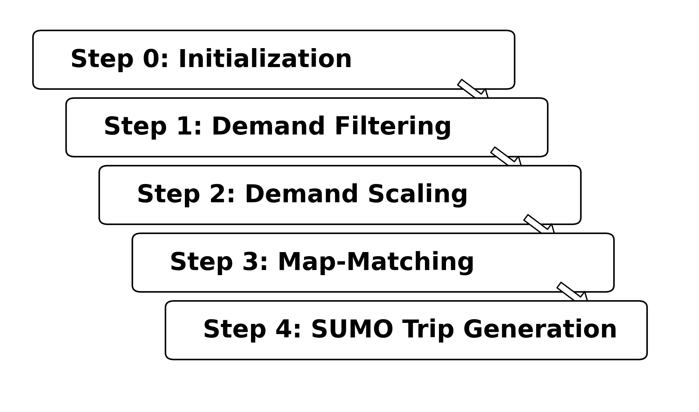

# MATSim-SUMO Pipeline

This repository contains an installable Python package for converting MATSim output into SUMO demand files.
The public command is `matsim-sumo`.

The pipeline reads MATSim plans, trips, events, and network files together with a SUMO network.
It generates a SUMO boundary, filters MATSim car demand to that boundary, optionally scales demand, map-matches trip endpoints to SUMO edges, writes SUMO trip XML, and can run `duarouter`.
The numbered pipeline steps are the steps shown in the overview figure and stop at Step 4.

<p align="center">
  
</p>

## Install

```bash
git clone <repo-url>
cd matsim-sumo-pipeline

python3 -m venv .venv
source .venv/bin/activate
pip install -e .
```

SUMO command-line tools are not installed by Python.
Install SUMO separately if you want to run `duarouter` or SUMO travel-time analysis.

## Input Layout

Use this local data layout for pipeline runs:

```text
data/
  inputs/
    matsim/
      output_network.xml.gz
      output_plans.xml.gz
      output_trips.csv.gz
      output_events.xml.gz
    sumo/
      scenario.net.xml
    amenities/
      locations.csv
```

Large input data under `data/` is intentionally ignored by Git.
Amenities and Microcensus data are not required for a default run.
Amenities are used only when `amenity_kdtree_enabled: true`.
Mode-share diagnostics are used only when `mode_share_diagnostics_enabled: true` or when running `matsim-sumo analyze-mode-shares` directly.

## Run

Copy the template and edit paths for your data:

```bash
cp configs/templates/pipeline.yaml configs/my_run.yaml
matsim-sumo run --config configs/my_run.yaml
```

The compatibility wrapper is also available:

```bash
python scripts/run_pipeline.py --config configs/my_run.yaml
```

`scripts/` intentionally contains only this wrapper.
All reusable code lives in `src/matsim_sumo/` or `analysis/`.

## Outputs

Pipeline outputs are written below the configured `output_dir`, normally under `results/`.
Generated outputs, caches, local data, and notebooks are ignored by Git.
Only source code, configuration templates/examples, documentation, tests, and lightweight reference files should be committed.

## Zurich network

`networks/zurich/zurich.net.xml` is a SUMO network for the City of Zürich, converted from OpenStreetMap.
It keeps passenger roads and tram tracks. Street-running track within 2 m of a road tagged `embedded_rails=tram` is joined into that road, so cars and trams share the lane. Reserved tram track stays tram-only.
Open that file in `sumo-gui` to view the network. Rebuild it with:

```bash
matsim-sumo extract-zurich-network
```

Intersection corrections are a separate step. The command reads `networks/zurich/zurich.net.xml` and does not modify it. It writes `results/zurich-correction/zurich.corrected.net.xml` and a report. Run the same command again after changing the rules. Each run starts from the unedited network.

```bash
matsim-sumo correct-zurich-network
sumo-gui -n results/zurich-correction/zurich.corrected.net.xml
```

### Repair against the National demand

`scripts/plans_to_sumo.py` follows each selected car and truck route (eqasim `lcv_*` agents become 6.5 m vans) in the EQASIM `output_plans.xml.gz` and keeps the part that runs on the Zürich network, so through traffic is included. `matsim_sumo.network.national_repair` then runs rounds of: an OpenStreetMap check that connects links leading nowhere, a simulation of those trips, a Google Routes check at every stuck approach, and the evolutionary search, which sends every individual back to OpenStreetMap. `GOOGLE_MAPS_API_KEY` must be set.

The repair runs in three stages:

1. **Sample demand.** The network is repaired with the National sample as it is: `SCALE=1 bash scripts/mac_national_repair.sh`. Results go to `repair-x1`.
2. **Full population.** The trips are cut again with a 30 min margin, then scaled as in Baggenstos (2026, Section 3.3.3):
   - The factor is 1 / sample share, read from `output_config.xml` (`sampleSize`).
   - Every original trip is kept, and its clones depart within ±30 min of it.
   - A clone end at an activity moves within 500 m to an agent home, workplace or school, weighted by the number of agents there. Boundary crossings stay fixed.
   - Only departures between 07:00 and 08:00 are kept.

   The repaired network is then repaired again at this volume. From this stage on, a vehicle counts as stuck after 300 s without moving, and stuck vehicles are counted from SUMO's `--statistic-output`.
3. **Signals and driver behaviour.**
   - `matsim_sumo.network.signal_timing` sets cycle length and green splits of every signal from the routed full demand with Webster's method (SUMO `tlsCycleAdaptation.py`). The signals stay actuated, with maximum green 1.25 × Webster's green. The guessed programs and a coordinated fixed-time plan (`tlsCoordinator.py`) are simulated for comparison. Junction pairs split by an edge shorter than a car, where vehicles collided, are joined. Output: `final.net.xml` and `signals.add.xml`.
   - `matsim_sumo.network.behaviour_calibration` searches car-following, yielding and lane-change parameters on that network with those signals. Its score is the teleported share plus the share of vehicles that never entered, plus any travel-time bias against Google Routes beyond ±10 %. The best setting is run again with a second seed, and approaches that stop vehicles in both runs are written to `hotspots.csv`.
   - `matsim_sumo.network.stuck_report` splits the stuck vehicles of the best run by time, approach and vehicle type. `matsim_sumo.network.count_check` compares it with the Zürich hourly traffic counts (GEH).

   Every stage after the repair routes the trips once (`matsim_sumo.network.simulation`), replaces routes that need a lane change the road markings forbid (`lane_routes`), and simulates with the same options, including SUMO's rerouting device. `best.sumocfg` therefore repeats the best run exactly.

```bash
python scripts/plans_to_sumo.py --net results/zurich-correction/zurich.corrected.net.xml --output plans.wide.trips.xml \
    --margin 1800 --endpoints plans.wide.ends.csv --amenities plans.amenities.csv
python scripts/scale_trips.py --input plans.wide.trips.xml --output plans.full.trips.xml \
    --matsim-config ~/Downloads/National/output_config.xml --endpoints plans.wide.ends.csv \
    --amenities plans.amenities.csv --net results/zurich-correction/zurich.corrected.net.xml
python -m matsim_sumo.network.national_repair --net repair-x1/final.net.xml --routes plans.full.trips.xml \
    --work-dir full-traffic/repair --rounds 3 --teleport 300
python -m matsim_sumo.network.signal_timing --net full-traffic/repair/final.net.xml --routes plans.full.trips.xml \
    --work-dir full-traffic/signals --collision-log full-traffic/repair/final.log
python -m matsim_sumo.network.behaviour_calibration --net full-traffic/signals/final.net.xml \
    --additional full-traffic/signals/signals.add.xml --routes plans.full.trips.xml --work-dir full-traffic/behaviour
python -m matsim_sumo.network.count_check --config full-traffic/behaviour/best.sumocfg --work-dir full-traffic/counts
sumo-gui -c full-traffic/behaviour/best.sumocfg -g scripts/arrows.view.xml
```

`scripts/mac_full_traffic.sh` runs stages 2 and 3 on a Mac, together with a run of the unrepaired network for comparison. Set `SCALE` to override the factor, `SKIP_BEFORE=1`, `SKIP_REPAIR=1`, `SKIP_SIGNALS=1` or `SKIP_BEHAVIOUR=1` to skip steps that have already finished, `SIGNALS=guessed|actuated|coordinated` to choose the signal programs, and `WORKERS` for the number of simulations run at once. Each `summary.json` holds the details of its stage, and `gridlocks.csv` and `hotspots.csv` list the approaches. `scripts/arrows.view.xml` draws vehicles as arrows coloured by speed.

## Euler

The cluster scripts are in `cluster/euler/`. From a machine on the ETH network or VPN, copy the repository to Euler, install it on a login node, and submit the short SUMO job:

```bash
ETH_USER=YOUR_ETH_USERNAME bash cluster/euler/sync_to_euler.sh
ssh YOUR_ETH_USERNAME@euler.ethz.ch
cd ~/matsim-sumo && bash cluster/euler/setup_euler.sh
sbatch cluster/euler/smoke_sumo.sbatch
```

The first SSH login asks for your ETH password and an email code. Login nodes are only for setup. See [cluster/euler/README.md](cluster/euler/README.md) for the pipeline job and the module versions.

## Documentation

See [WIKI.md](WIKI.md) for full installation, configuration, run, output, and troubleshooting notes.
See [AGENT.md](AGENT.md) for repository guidance for coding agents.
